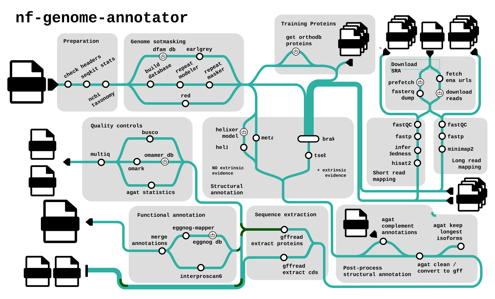

<h1>
  <picture>
    <source media="(prefers-color-scheme: dark)" srcset="docs/images/nf-core-genomeannotation_logo_dark.png">
    
  </picture>
</h1>

[](https://github.com/codespaces/new/nf-core/genomeannotation)
[](https://github.com/nf-core/genomeannotation/actions/workflows/nf-test.yml)
[](https://github.com/nf-core/genomeannotation/actions/workflows/linting.yml)[](https://nf-co.re/genomeannotation/results)[](https://doi.org/10.5281/zenodo.XXXXXXX)
[](https://www.nf-test.com)

[](https://www.nextflow.io/)
[](https://github.com/nf-core/tools/releases/tag/4.2.1)
[](https://docs.conda.io/en/latest/)
[](https://www.docker.com/)
[](https://sylabs.io/docs/)
[](https://cloud.seqera.io/launch?pipeline=https://github.com/nf-core/genomeannotation)

[](https://nfcore.slack.com/channels/genomeannotation)[](https://bsky.app/profile/nf-co.re)[](https://mstdn.science/@nf_core)[](https://www.youtube.com/c/nf-core)

## Introduction

**nf-core/genomeannotation** is a bioinformatics pipeline that performs end-to-end genome annotation (structural + functional) for **eukaryotic organisms**. After sequencing and assembling a genome, annotation is essential to identify gene locations and their functions. However, the annotation process can be complex, time-consuming, and challenging for less experienced users. The **nf-core/genomeannotation** pipeline aims to simplify this process, offering users a seamless and intuitive experience while ensuring high-quality annotations.

<p align="center">
    
</p>

## Pipeline overview

The pipeline is built using [Nextflow](https://www.nextflow.io/) and processes data in multiple distinct steps.

>[!TIP]
>Note: Except for data preparation and reporting, all steps are optional. For example, you can use a `gff` file from a previous run (or another tool) and proceed directly to sequence extraction (proteome + CDS), functional annotation, and quality control.

#### 1. Data preparation (mandatory)

- Check genome sequence and IDs
- Compute general statistics from the genome sequence
- Fetch taxonomy information corresponding to the provided species / taxon ID

#### 2. Genome masking (optional)

Some structural annotators, such as **BRAKER**, require genome softmasking. The pipeline offers multiple options for repeat masking:

- **RepeatModeler / RepeatMasker (default)**: The standard tool suite for repeat masking, using a minimal Dfam database. Moderate speed.
- **Red**: A fast but less accurate repeat masker, relying solely on genome sequence. Extremely fast.
- **earlGrey**: A highly accurate repeat masker that uses a custom Dfam database tailored to the closest available clade of the provided species. Slow to very slow.

>[!NOTE]
>earlGrey requires users to download the relevant portion of the Dfam database. **nf-core/genomeannotation** automates this process using a custom multithreaded download script based on the **famdb** package.

#### 3. Preparation of RNA-seq data (optional)

Structural annotators like **BRAKER** or **Tiberius** can use short- or long-read RNA-seq data to enhance gene model accuracy. With **nf-core/genomeannotation**, users can provide their own RNA-seq data (in `fastq` or `bam` format) for these tools. Additionally, the pipeline offers an opt-out feature to automatically retrieve a random set of SRA/ENA IDs specific to the provided species and download the corresponding `fastq` files.

If required by downstream tools, `fastq` files can be mapped to the genome prior to structural annotation.

#### 4. Structural annotation (optional)

Users can choose between multiple structural annotators:

- **Braker3**
- **Helixer**
- **Metaeuk**

>[!NOTE]
>For technical reasons, **BRAKER4** is not yet available in **nf-core/genomeannotation**. We are actively working to overcome these limitations.

>[!NOTE]
>**Metaeuk** should be chosen only for small eurakyotic organisms.

>[!WARNING]
>**Helixer** relies on deep learning models, so inference is significantly faster when run on GPUs rather than CPUs.

#### 5. Annotation post-processing (optional)

- The structural annotation (or the annotation provided by the user if structural annotation was skipped) is cleaned using **AGAT**.
- Alternative annotations are produced (longest transcript isoforms only, etc.).
- CDS and Protein sequences are extracted as `fasta` files using **gffread**.

#### 6. Functional annotation (optional)

Users can select one or more functional annotators from the following options:

- **eggNOG-mapper**
- **Interproscan5**

If multiple annotators are chosen, their results are merged into a unified annotation.

#### 7. Quality controls (optional)

Quality controls are performed using:

- **BUSCO**
- **OMark**
- **AGAT**

#### 8. Reporting

**nf-core/genomeannotation** uses **MultiQC** to generate a dedicated QC report for each annotated genome.


## Usage

> [!NOTE]
> If you are new to Nextflow and nf-core, please refer to [this page](https://nf-co.re/docs/get_started/environment_setup/overview) on how to set-up Nextflow. 

### Test run

Make sure to [test your setup](https://nf-co.re/docs/get_started/run-your-first-pipeline) with `-profile test` before running the workflow on actual data:
```bash
nextflow run nf-core/genomeannotation -profile <PROFILE (ex: docker)>,test --outdir <OUTDIR>
```

### Basic usage

First prepare a samplesheet in `yaml` / `json` / `csv` format, with at least these mandatory fields :

- the sequence of the genome in `fasta` format (compressed or not)
- a NCBI Taxon ID (or a species name recognised by **NCBI Taxonomy**)
- a genome ID is used for naming files, particularly the final annotation output

Now, you can run the pipeline using:

```bash
nextflow run nf-core/genomeannotation \
   -profile <docker/apptainer/singularity/.../institute> \
   --input samplesheet.yaml \
   --outdir <OUTDIR>
```

> [!WARNING]
>For certain tools, such as **BRAKER3**, the `conda` profile is not supported in this pipeline. We recommend using `apptainer`, `singularity` or `docker` instead.


> [!WARNING]
> Please provide pipeline parameters via the CLI or Nextflow `-params-file` option. Custom config files including those provided by the `-c` Nextflow option can be used to provide any configuration _**except for parameters**_; see [docs](https://nf-co.re/docs/running/run-pipelines#using-parameter-files).

For more details and further functionality, please refer to the [usage documentation](https://nf-co.re/genomeannotation/usage) and the [parameter documentation](https://nf-co.re/genomeannotation/parameters).

## Pipeline output

To see the results of an example test run with a full size dataset refer to the [results](https://nf-co.re/genomeannotation/results) tab on the nf-core website pipeline page.
For more details about the output files and reports, please refer to the
[output documentation](https://nf-co.re/genomeannotation/output).

## Credits

nf-core/genomeannotation was originally written and is currently developed by Olivier Coen, as a postdoctoral researcher at the [EGCE](https://www.egce.universite-paris-saclay.fr/) ([Université Paris-Saclay](https://www.universite-paris-saclay.fr/), [CNRS](https://www.cnrs.fr/fr)).

We thank the following people for their extensive assistance in the development of this pipeline:

<!-- TODO nf-core: If applicable, make list of people who have also contributed -->

## Contributions and Support

If you would like to contribute to this pipeline, please see the [contributing guidelines](docs/CONTRIBUTING.md).

For further information or help, don't hesitate to get in touch on the [Slack `#genomeannotation` channel](https://nfcore.slack.com/channels/genomeannotation) (you can join with [this invite](https://nf-co.re/join/slack)).

## Citations

<!-- TODO nf-core: Add citation for pipeline after first release. Uncomment lines below and update Zenodo doi and badge at the top of this file. -->
<!-- If you use nf-core/genomeannotation for your analysis, please cite it using the following doi: [10.5281/zenodo.XXXXXX](https://doi.org/10.5281/zenodo.XXXXXX) -->

<!-- TODO nf-core: Add bibliography of tools and data used in your pipeline -->

An extensive list of references for the tools used by the pipeline can be found in the [`CITATIONS.md`](CITATIONS.md) file.

You can cite the `nf-core` publication as follows:

> **The nf-core framework for community-curated bioinformatics pipelines.**
>
> Philip Ewels, Alexander Peltzer, Sven Fillinger, Harshil Patel, Johannes Alneberg, Andreas Wilm, Maxime Ulysse Garcia, Paolo Di Tommaso & Sven Nahnsen.
>
> _Nat Biotechnol._ 2020 Feb 13. doi: [10.1038/s41587-020-0439-x](https://dx.doi.org/10.1038/s41587-020-0439-x).

